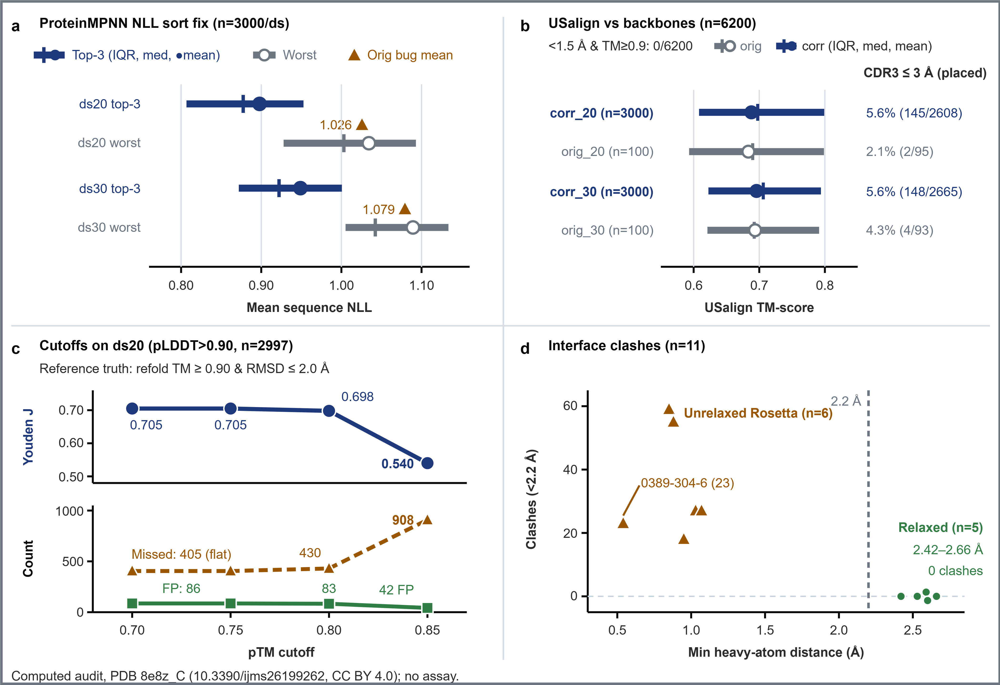

# NanoDeNovo

NanoDeNovo is an automated eight-stage nanobody design pipeline targeting PDB 8e8z_C (DOI 10.3390/ijms26199262). This repository pairs repaired legacy scripts with clean verification tools, pinned dependencies, and an interactive terminal console. Every figure and metric comes from computational coordinates and logs on disk, with zero laboratory assays measured so far.

## Pipeline overview

| Stage | Module | Role |
|---|---|---|
| S1 | `pipeline/rfantibody_wrapper2.py`, `tools/design_rfantibody.py` | Validate RFantibody arguments and check scaffold PDB coordinates |
| S2 | `pipeline/run_proteinmpnn_batch.sh`, `tools/batch_mpnn.py` | Generate single-session ProteinMPNN sequence batches across backbones |
| S3 | `pipeline/process_sequences.py`, `tools/select_sequences.py` | Rank sampled candidates in ascending negative log-likelihood order |
| S4 | `pipeline/tfold_ab_runner.py`, `tools/fold_ab.py` | Fold selected monomers and check structural confidence CSVs |
| S5 | `pipeline/align_pipeline_kwargs.py`, `tools/cdr3_check.py`, `tools/align_all.py` | Compute USalign TM-scores and Kabsch CDR3 loop deviations |
| S6 | `pipeline/tfold_ag_dock_kwargs.py`, `tools/interface_check.py` | Parse complex REMARK scores and measure buried surface area |
| S7 | `2_sequence_and_structure_assessement/openmm_em/openmm_minimizer.py` | Minimize complex clashes in AMBER14 GBn2 with C-alpha restraints |
| S8 | `pipeline/build_plots.py`, `tools/qc_report.py`, `nanodenovo_tui/workflow.py` | Generate Youden J audit reports and verify SHA-256 ledgers |

## Audit findings

Reversing the original ProteinMPNN descending score bug lowered mean selected NLL in dataset 20 from 1.0257 to 0.8979. Mean selected NLL in dataset 30 fell from 1.0793 to 0.9489.

Live Cloud Run NanoBodyBuilder2 refolding produced 6,000 corrected traces plus 200 paired controls. USalign measured mean TM-scores of 0.6880 in dataset 20 and 0.6958 in dataset 30. Paired controls measured 0.6834 and 0.6936. Out of 6,200 refolds, zero designs met the 2.0 angstrom and TM >= 0.90 threshold.

Adjusting dataset 20 cutoffs from `pTM > 0.85` to `pTM > 0.70` at `pLDDT > 0.90` raises Youden J from 0.540 to 0.705. False-negative misses fall from 908 to 405 designs.

Unrelaxed docked complexes in `results/interface_audit.csv` show 18 to 59 heavy-atom clashes below 2.2 angstrom. OpenMM minimization clears clashes to 0 with minimum distances above 2.4 angstrom. Detailed defect notes sit in [AUDIT.md](AUDIT.md), [reports/quality_20.md](reports/quality_20.md), and [reports/quality_30.md](reports/quality_30.md).

## Publication plate



The 178 mm vector plate in `figs/nanodenovo_audit_plate.png` summarizes NLL quartiles, USalign refold cohorts, Youden J cutoffs, and interface clash measurements. Provenance and QA notes live beside the figure in `figs/nanodenovo_audit_plate.notes.md`.

## Dependency setup

Pinned package versions and binary checks live in `config/dependencies.json`, `requirements-lock.txt`, `pyproject.toml`, and `environment.wsl.yml`.

Create or verify the Windows environment in PowerShell:

```powershell
Set-Location "<path-to>\NanoDeNovo"
.\scripts\setup_deps.ps1
py -3 nanodenovo.py --doctor
```

Create or check the WSL2 GPU environment for USalign and structure prediction:

```bash
cd /mnt/<drive>/<path-to>/NanoDeNovo
bash scripts/setup_deps.sh
python3 nanodenovo.py --doctor
```

## Workflow console

Launch the interactive terminal interface after verifying dependencies:

```powershell
Set-Location "<path-to>\NanoDeNovo"
py -3 nanodenovo.py --ui rich
```

Press `1` through `8` to run one stage, or press `a` to execute all stages sequentially. Press `m` to cycle between `replay`, `dry-run`, and `live`, press `d` for the dependency doctor, press `i` for built-in instructions from `docs/INSTRUCTIONS.md`, and press `v` to verify `results/ledger.jsonl`.

## Headless commands

Run deterministic replay verification, preflight checks, tests, or self-checks from PowerShell:

```powershell
Set-Location "<path-to>\NanoDeNovo"
py -3 -I nanodenovo.py --doctor
py -3 -I nanodenovo.py --instructions
py -3 -I nanodenovo.py --headless --mode replay
py -3 -I nanodenovo.py --verify-ledger
py -3 -I nanodenovo.py --selftest
py -3 -m pytest tests
```

Run a single stage in dry-run or live mode:

```powershell
py -3 nanodenovo.py --headless --stage S3 --mode dry-run
py -3 nanodenovo.py --headless --stage S6 --mode live
```

## Repaired codebase

All pre-existing data directories (`1_virtual_screening/`, `3_cdr_desing/`, and `.github/`) remain intact for reproducibility. Hardened scripts in `pipeline/` fix multiline FASTA parsing, anchored REMARK 250 extraction, argument parsing, OpenMM minimization flags, and backslash quoting while `tools/` provides clean CPU audit utilities. Built-in operator documentation resides in [docs/INSTRUCTIONS.md](docs/INSTRUCTIONS.md).

## Evidence boundary

Every sequence score, refold RMSD, buried surface area, clash count, and Youden J metric in this repository is purely computational. Wet-lab binding, expression, and thermostability experiments remain unmeasured.

## Nano-2 workflow

Nano-2 is the November 2026 clean-room successor built on open MIT, BSD, and Apache components. It introduces `SE(3)` quotient-star bias, confluent sequence repair, Mondrian conformal bounds, and Schur DPP selection.
